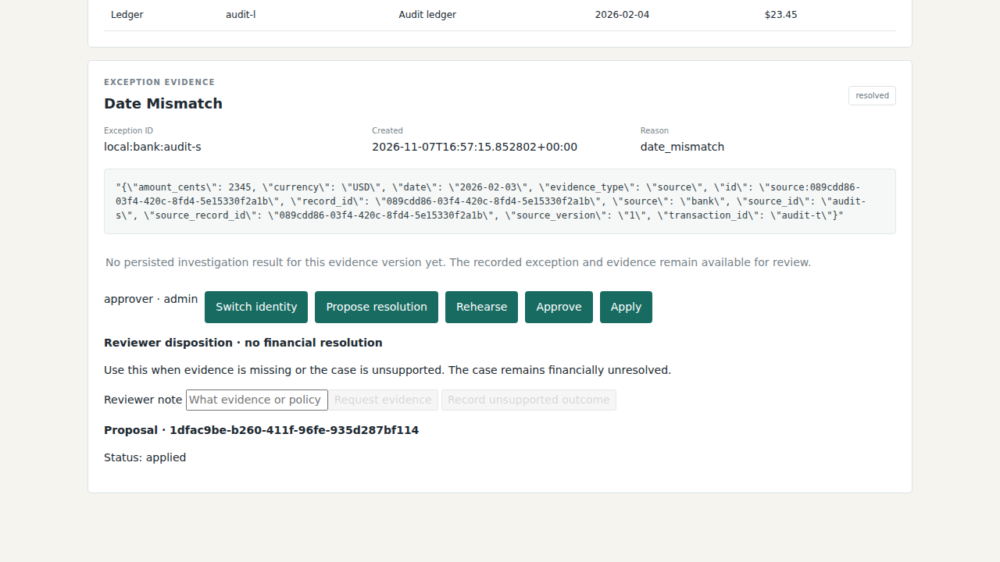

# Ledger Rehearsal

**Beta. An evidence-backed reconciliation workbench, not an autonomous bookkeeper.**

Ledger Rehearsal helps a reviewer answer a practical question: what evidence supports this proposed reconciliation, and what will change if we approve it?

Import bank and ledger records, investigate exceptions, rehearse a proposed resolution without writing changes, and require a separate approver before applying an internal allocation. Missing evidence stays visible. An unsupported case does not become resolved just because an agent finished running.


## Why this exists

ScaleFactor's story prompted the project, particularly the gap between promising automated bookkeeping and delivering dependable operations. This is a focused engineering response to that gap, not a claim that reconciliation alone caused the company's failure or that this beta would have prevented it.

The design puts a boundary between **an agent's suggestion** and **an authorized financial change**. That boundary is the product, not an obstacle to automate away.

## What you can do

- Preview and validate CSV bank/ledger imports, with row-level errors and explicit currency semantics.
- Review discrepancies alongside the records that produced them.
- Run a bounded, read-only investigation and retain its evidence references.
- Create a resolution proposal and rehearse its consequences without applying it.
- Approve under a different authenticated identity, then apply and read back the internal result.
- Request missing evidence or record an unsupported outcome without falsely closing a financial case.
- Export evidence and review history as JSON or CSV.



Screenshots use synthetic records. Applying a proposal changes internal reconciliation state. It does **not** post a journal entry, move money, or update an external accounting platform.

## Run locally

Prerequisites: Python with `venv`, Node.js and npm. The backend has been tested locally on Python 3.14; other Python versions and Windows execution have not been independently verified. Use synthetic records while evaluating the beta.

### Linux / WSL

```bash
git clone https://github.com/mdhasim-1406/ledger-rehearsal.git
cd ledger-rehearsal
bash scripts/setup.sh
read -rs -p 'Private bootstrap credential (16+ characters): ' OPERATIONAL_ADMIN_CREDENTIAL
export OPERATIONAL_ADMIN_CREDENTIAL
printf '\n'
bash start.sh
```

Open http://127.0.0.1:28752. The API listens on http://127.0.0.1:8765. The bootstrap credential provides administrator access; keep it private. Use separate reviewer and approver identities to exercise the approval boundary, as documented in [the operational handoff](docs/OPERATIONAL_HANDOFF.md).

### Windows

Run `scripts\setup.bat`, set `OPERATIONAL_ADMIN_CREDENTIAL` privately in your shell, then run `start.bat`. The Windows scripts are included, but have not been executed in the verification environment. Do not save credentials in a batch file or commit them.

### Configuration

| Variable | Purpose |
| --- | --- |
| `OPERATIONAL_ADMIN_CREDENTIAL` | Private bootstrap credential, at least 16 characters |
| `OPERATIONAL_DB` | Durable domain database path; defaults to `data/operational.sqlite3` |
| `OPERATIONAL_PORT` | API port, default `8765` |
| `LEDGER_FRONTEND_PORT` | UI port, default `28752` |
| `INVESTIGATION_LLM_BASE_URL` | OpenAI-compatible provider base URL |
| `INVESTIGATION_LLM_MODEL` | Provider model identifier |
| `INVESTIGATION_LLM_API_KEY` | Provider credential, backend environment only |

Without a working provider, manual review remains available; model investigations are not successful merely because jobs are queued. The Linux launcher supplies a model default and can use an existing local gateway credential when no custom investigation endpoint is configured. For another provider, explicitly set all three investigation settings. Never put credentials in frontend environment variables.

## Architecture and ownership

```text
React operator UI
  -> authenticated FastAPI API
  -> versioned evidence + transactional outbox
  -> durable worker with leases and fencing
  -> LangGraph investigation, separate SQLite checkpoints
  -> validated proposal
  -> no-write rehearsal
  -> separate human approval
  -> transactional internal application + audit/readback
```

**The domain database owns truth.** Records, evidence versions, proposals, approvals, allocations and audit history live there. Money is compared using exact decimal semantics, not floating-point equality.

**LangGraph owns investigation progress.** Its checkpoints contain execution state, not financial authority. Tools are bounded and read-only. Changed evidence gets a different investigation identity, and the worker rechecks current evidence and lease ownership before persisting a result.

**The durable worker owns dispatch retries.** There is no competing custom agent loop or nested graph retry policy. Draft and result persistence share a transaction; replay must not produce duplicate drafts.

Read [investigation ownership](docs/INVESTIGATION_ORCHESTRATION.md), [API contract](backend/OPERATIONAL_CONTRACT.md), and [backup/recovery](docs/RECOVERY.md) for implementation details.

## Verify the beta

```bash
backend/.venv/bin/python -m pytest -q backend/tests
npm --prefix frontend run build
backend/.venv/bin/python scripts/smoke_operational.py
```

The current local baseline is 109 backend tests passing. Tests cover exact-money matching, stale evidence, authorization, atomic persistence, retries, process recovery and same-investigation serialization. Passing tests do not establish accounting correctness on customer workloads.

Browser acceptance scripts:

```bash
backend/.venv/bin/python scripts/verify_browser_lifecycle.py
backend/.venv/bin/python scripts/verify_operator_workflows.py
```

These exercise the approval/apply flow and CSV import, missing-evidence disposition and downloads. They create scratch databases and isolated ports. They currently reference the maintainer's installed Playwright package path; adjust that path to your local installation before running elsewhere. `TMPDIR` must point to a writable scratch directory. This portability limitation is tracked as beta work, not hidden behind a build badge.

## Scope and limitations

- Single workspace, single host. SQLite and local file locks are not a multi-host/high-availability design.
- Live-model investigation reliability remains unverified. Mocked provider tests prove protocol and safety behavior, not useful accounting judgment.
- No external posting, payment execution, general bookkeeping automation, split/aggregate matching or foreign-exchange policy is promised.
- No accountant-reviewed pilot or measured reduction in operating cost has been completed. Unmeasured effort and model cost are reported as unknown.
- Local loopback defaults are not a hardened internet deployment. Do not expose the Vite development server or bootstrap credential publicly.
- Checkpoints contain evidence. Protect them like the domain database, and review provider data handling before submitting sensitive records.

## Repository map

```text
backend/                 Domain services, API, worker and investigation graph
backend/tests/           Behavioral, safety and process-recovery tests
frontend/src/rebuild/    Current operational React UI
scripts/                 Setup, smoke, backup and browser checks
docs/                    Operational contracts and engineering notes
```

A legacy synthetic demo is retained separately in `backend/main.py`. The supported launchers select operational mode; the demo is not the financial service. Older design notes describe earlier stages and are not release evidence.

## Contributing

Start with a reproducible failing case and the expected domain outcome. Keep money/evidence/authorization rules in domain services, not prompts. New resolution types need explicit policy, adversarial tests and observable readback. Do not commit databases, credentials, checkpoints or customer evidence.

For a security issue, contact the maintainer privately through the GitHub profile rather than opening an issue containing financial data or credentials.

Built by [Mohamed Hasim](https://github.com/mdhasim-1406). Feedback from finance and operations reviewers is particularly useful: what evidence would you need before accepting a proposed reconciliation?
